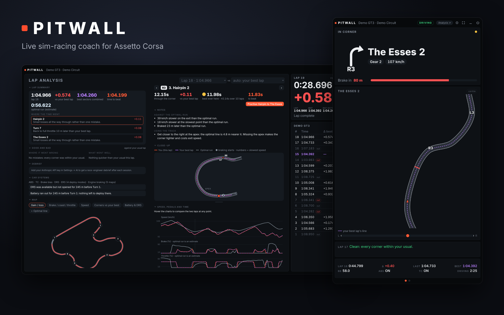
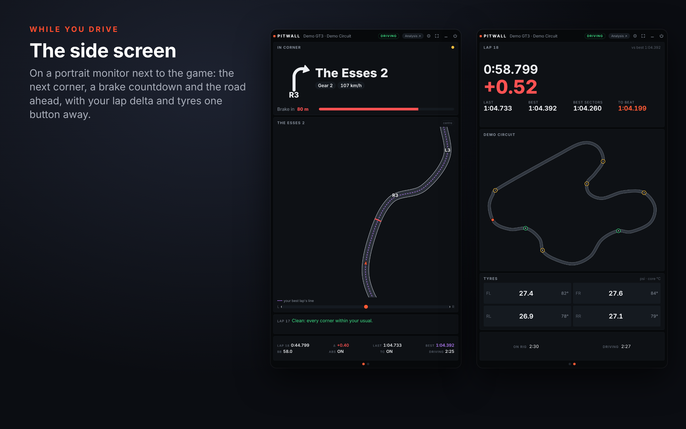
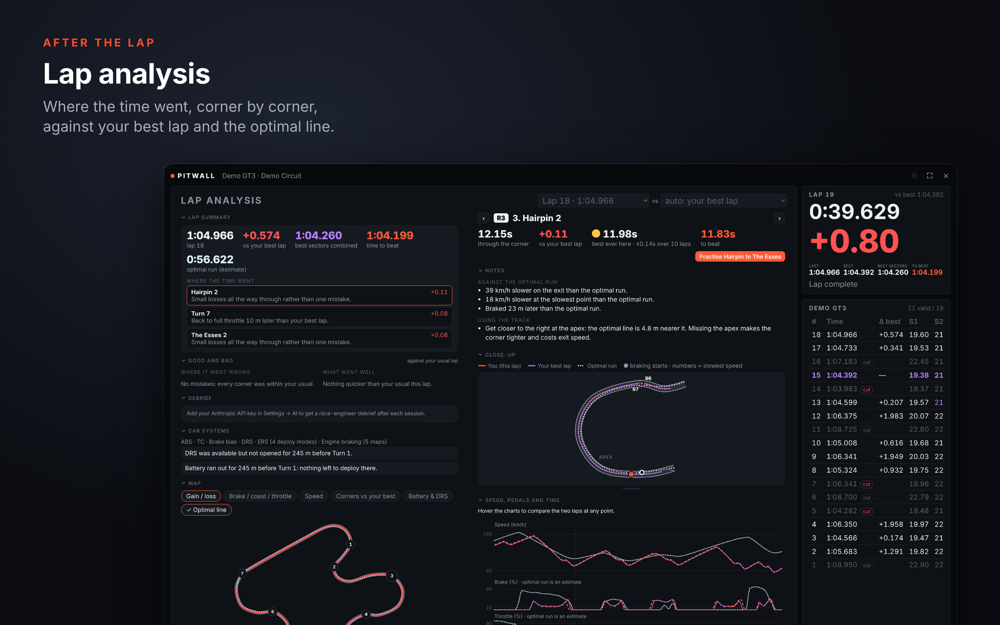
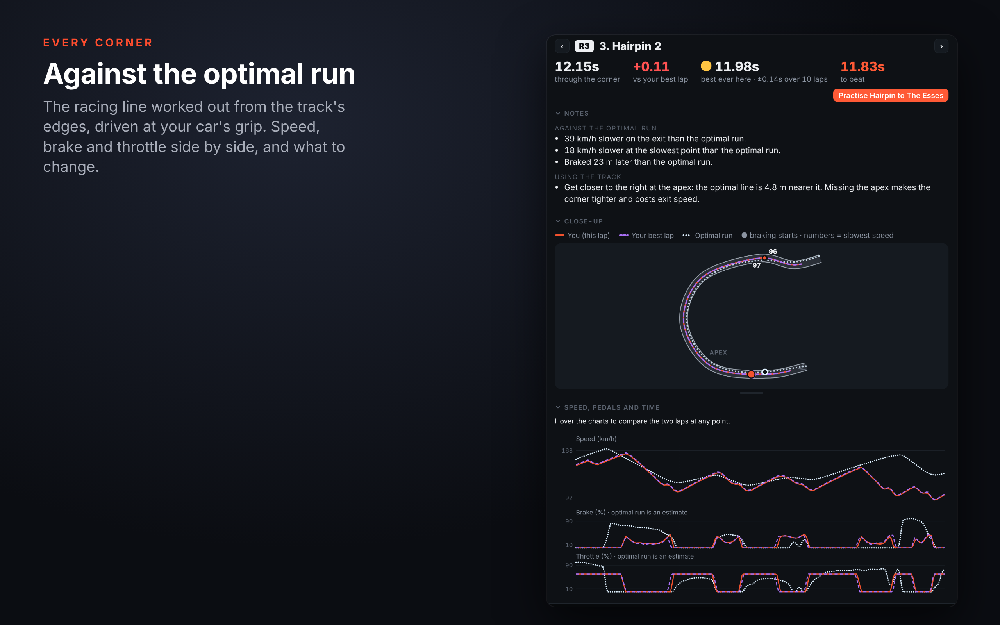
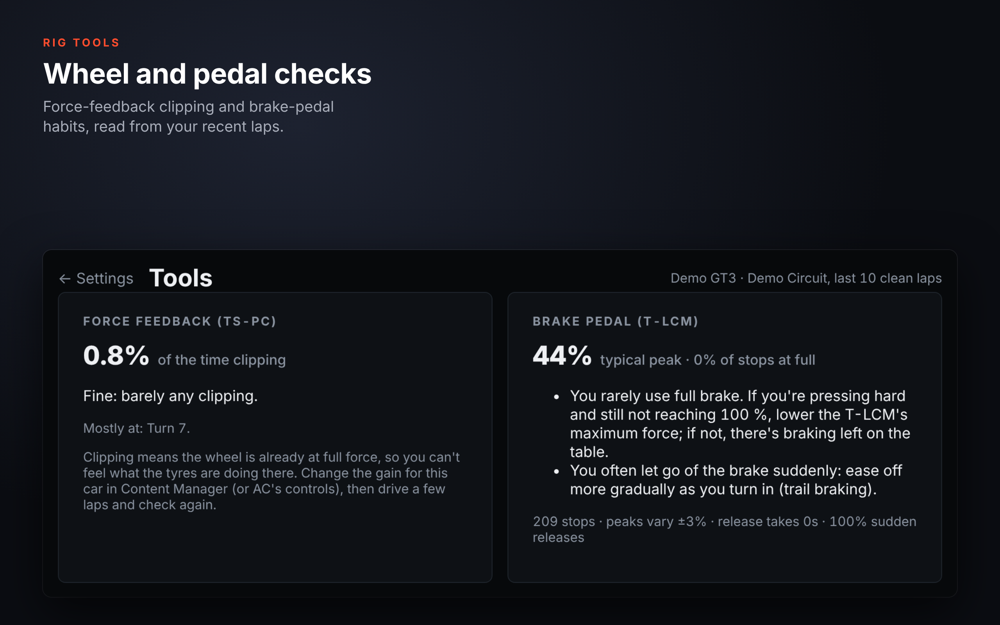

# Pitwall



A sim-racing coach for Assetto Corsa. A live dashboard runs on a vertical
second monitor while you drive; after each lap it shows where the time went
and what to change. Laps sync to a cloud hub you can open on a laptop or
phone. [SPEC.md](SPEC.md) has the whole plan.

## What it does

**While you drive.** The side screen shows the next corner, a brake
countdown, the road ahead and a coach strip (this session's focus, each
lap's biggest mistake, cold tyres). A second page has the lap timer, live
delta, track map and tyres. Drills use one-button rewind (CSP Time Shift)
with a timer in the game.



**After the lap.** Corner-by-corner analysis against your best lap or the
optimal run, "good and bad", a time to beat, and an AI debrief from Claude.



**The optimal run.** Pitwall reads each track's layout from the game files
(corners, practice sections, Nordschleife chapters), works out a racing line
from the track's edges and drives it at your car's grip, learnt from your
fastest laps. Each corner gets speed, brake and throttle against it, plus
plain notes on what to change.



**Rig tools.** A force-feedback clipping meter and a brake-pedal check for
the T-LCM, both read from your recent laps.



The screenshots come from the built-in demo car (see
[Screenshots](#screenshots)).

## What's in the repo

```
rig/        Python service: reads the game, records laps, serves the dashboard
dashboard/  React + TypeScript dashboard (portrait 1080×1920, also works on a laptop)
csp/        In-game CSP app (overlay, drills)
cloud/      Supabase schema and the debrief function
scripts/    Windows helpers (setup, start, demo)
docs/       Research notes, reviews, and the screenshots with the script that makes them
```

## Running it on the rig PC (Windows)

One-time setup — install [uv](https://docs.astral.sh/uv/) and Node.js, then run
`scripts\setup.bat`:

```bat
winget install astral-sh.uv
winget install OpenJS.NodeJS.LTS
scripts\setup.bat
```

Then, whenever you drive:

```bat
scripts\start.bat
```

This rebuilds the dashboard if needed, starts the service, and opens the
dashboard full-screen on the vertical monitor (found automatically; Chrome
preferred, Edge as a fallback). If it picks the wrong screen, choose one under
**Settings → General** (the gear icon, or `http://localhost:8765/#/settings`).

- **Analysis ↗** (top bar) opens the full lap analysis on your main screen.
  Each corner's close-up shows an **optimal racing line** (dotted), worked
  out from the track's edges; **+ Optimal line** adds it to the lap map. The
  track-width tips say how far you were from it at turn-in, apex and exit.
  Once you have a few clean laps, the **optimal run** (that line driven at
  your car's grip, learnt from your fastest laps) adds optimal speed, brake and
  throttle to the corner charts, an Optimal run column, notes on where you
  differ, and an estimated lap time.
- The **fullscreen** button (corner arrows, or the **F** key) goes fullscreen, on the PC and on the hub.
- **Settings → Coaching** holds everything about how you're coached.
- **Tools** (top of Settings, or `#/tools`) has a force-feedback clipping
  meter (from your recent laps) and a brake pedal check for the T-LCM.
- The **–** button minimises the dashboard; **⏻** stops Pitwall.
- Press **L** on the dashboard for the lag meter and **Record performance**
  (saves a report to `%APPDATA%\Pitwall\perf`).

Try it without the game: `scripts\demo.bat`.

### Wheel buttons

Settings → Controls → **Set up recommended controls** walks you through binding
rewind, drills, pages and analysis to wheel buttons. Or bind any single action
with **Bind wheel / pedal**: press the SF1000 button, turn an encoder or pull a
clutch paddle. Keyboard shortcuts work too (default `Ctrl+Alt+→` / `Ctrl+Alt+←`
to change page, `Ctrl+Alt+M` to mark a spot), even while the game has focus.

### SF1000 wheel screen (over Wi-Fi)

Thrustmaster doesn't let other programs drive the screen over USB, so Pitwall
sends the F1 23 game's UDP format to the wheel instead, and its F1 pages work
in AC (gear, RPM lights, lap times, fuel, tyres, brake bias, ABS / TC, DRS).

1. Update the wheel to firmware 6.27 or later (Thrustmaster's driver app).
2. On the wheel, join your Wi-Fi and turn on UDP mode (port 20777). Note its IP.
3. Settings → Controls → **SF1000 wheel screen**: turn on **Send to the wheel**, enter the **Wheel IP**, then **Test** sweeps
   the rev lights and gears.

### Rewind and drills (CSP Time Shift)

Bind the same key in CSP's **Time Shift** app as **Settings → Controls → Time
Shift rewind key** (default `Insert`). The **Rewind** button then rewinds while
held. During a drill, one press rewinds to a run-up before the section
(**Drill run-up**, 4 s by default). Time Shift only works offline, in
single-car practice.

### In-game app (CSP)

`scripts\start.bat` copies Pitwall's in-game app into Assetto Corsa
(`apps\lua\Pitwall`) and keeps it up to date. In AC, open it from the app
bar (the Pitwall icon). It adds:

- **Next corner and Brake in** inside the game, worked out every frame with
  no lag (the brake point adjusts to how fast you're arriving).
- **Instant drill retry.** As you pass a drill's run-up point the app saves
  the car exactly as it is; Rewind during the drill puts you straight back
  there at full speed (offline practice only, like Time Shift; Time Shift is
  the fallback).
- **Go there.** In analysis, **Go there** next to a section or chapter starts
  the drill and teleports you before it, stopped on the racing line. It's far
  enough back that pulling away flat out gets you to the section at your usual
  speed (worked out from how your best lap accelerates), and always behind
  the rewind run-up. Teleporting only gets you there; retries rewind as above.
  Offline practice only.
- **Real ABS / TC levels and brake bias** on the dashboard instead of ON/OFF.

The app needs the Pitwall service running. If it says "Pitwall isn't
running", start `scripts\start.bat`.

### Cloud hub (laps on the MacBook)

Pitwall can upload your laps to your own free Supabase project, so the hub can
show them while the PC is off. One-time setup:

1. Create a project at [supabase.com](https://supabase.com) (free tier is plenty).
2. In the project: **SQL Editor → New query**, paste all of
   [`cloud/schema.sql`](cloud/schema.sql), **Run**. That creates the tables and
   the rules that only let your login see your data.
3. **Authentication → Users → Add user → Create new user**: your email and a
   password, with **Auto Confirm User** ticked.
4. **Project Settings → API**: copy the **Project URL** and the **anon public** key.
5. In Pitwall: **Settings → Cloud**, paste both, enter the email and password,
   **Connect**.

From then on every lap uploads in the background (with its corner analysis,
telemetry at ~20 samples a second, the track layout and the car's profile).
Laps driven offline upload when you're back online. Your password isn't
stored; Pitwall keeps a sign-in token in `%APPDATA%\Pitwall\cloud.json`.
Demo and replay laps stay on the PC.

**The hub website** (your laps on the MacBook or phone) is hosted free on
Vercel. One-time setup:

1. Sign in at [vercel.com](https://vercel.com) with GitHub, then **Add New →
   Project** and import the Pitwall repository.
2. **Root Directory**: `dashboard`. Leave the framework as **Other**: the
   build settings come from `dashboard/vercel.json`.
3. **Environment Variables**: `VITE_SUPABASE_URL` and `VITE_SUPABASE_ANON_KEY`,
   the same Project URL and anon key you gave Pitwall.
4. **Deploy**, open the address it gives you, and sign in with the same email
   and password.

It redeploys by itself whenever `main` changes on GitHub. Run it locally with
`npm run dev:hub` (in `dashboard`, with the two variables set).

**Database updates apply themselves.** When a change to `cloud/schema.sql`
reaches `main`, a GitHub Action applies it to your Supabase database. One-time
setup:

1. In Supabase, click **Connect** (top of the project), choose **Session
   pooler** and copy the URI. Put your database password in place of
   `[YOUR-PASSWORD]` (forgotten it? **Project Settings → Database → Reset
   database password**).
2. On GitHub: the Pitwall repository → **Settings → Secrets and variables →
   Actions → New repository secret**. Name `SUPABASE_DB_URL`, value the URI.
3. **Actions → Apply database schema → Run workflow** once, to check it works.

If Pitwall's Settings → Cloud ever says the tables are out of date, check
that the Action ran (GitHub → Actions), or run it again from there.

### AI debrief

After a session with at least 3 clean laps, Claude writes a short
race-engineer debrief: the one change worth the most time (where, what to do,
a target), a couple of smaller notes, what's going well, and a section to
drill. It shows in the analysis (PC and hub). Setup: create an API key at
[console.anthropic.com](https://console.anthropic.com) (API Keys, and add some
credit under Billing), then paste it into **Settings → AI**. It's checked,
then kept on the PC only (`%APPDATA%\Pitwall\ai.json`). Each debrief costs
roughly 10 cents. Turn automatic debriefs off in the same tab; the
**Write debrief** button in the analysis still works.

**Debriefs from the hub (PC off).** The hub can write one too, for your latest
session on the car + track you're looking at. The key then also lives in
Supabase as a hidden secret (never in the browser), and a GitHub Action puts
it there. One-time setup, in GitHub under **Settings → Secrets and variables →
Actions → New repository secret**:

1. `SUPABASE_ACCESS_TOKEN`: make one at
   [supabase.com/dashboard/account/tokens](https://supabase.com/dashboard/account/tokens)
   (**Generate new token**).
2. `ANTHROPIC_API_KEY`: the same key as on the PC.
3. `PITWALL_EMAIL`: the email you sign in to the hub with. Only that account
   can write debriefs, so nobody else can spend your credit.

Then **Actions → Deploy hub function → Run workflow**. When it's green, the
hub's analysis has a **Write debrief** button. It uses `SUPABASE_DB_URL` (from
the database step above) to know which project; if it can't tell, it asks for
a `SUPABASE_PROJECT_REF` secret. New key later? Update the secret and run the
workflow again.

### Recording a session (helps development)

```bat
scripts\start.bat --record "%USERPROFILE%\Desktop\spa.pwrec"
```

A `.pwrec` file is the raw telemetry of that session. It can be replayed through
the dashboard anywhere: `pitwall-rig run --replay spa.pwrec`.

## Where things are stored

Settings and laps live in `%APPDATA%\Pitwall` (`~/.pitwall` on Mac/Linux):
`config.json` (everything the Settings page edits) and `pitwall.sqlite` (every
lap with its full telemetry trace).

## Development

```bash
# rig service
cd rig
uv sync
uv run pytest
uv run pitwall-rig run --game demo --time-scale 4   # fake car, 4× speed

# dashboard (hot reload on :5173, talks to the rig service on :8765)
cd dashboard
npm install
npm run dev
npm test
```

On macOS/Linux there's no Assetto Corsa, so use `--game demo` or `--game replay`.

### Screenshots

The images in `docs/screenshots/` (2560×1600, 16:10) are made from the demo
car by a script, so they can be remade after the UI changes:

```bash
cd dashboard && npm run build && cd ..
node docs/screenshots/make.js
```

It needs uv and Playwright with Chromium (both are in Claude Code cloud
sessions). It starts its own service on port 8799 with a throwaway data
folder, lets the demo car drive about ten clean laps at 8× speed, then
screenshots the dashboard, analysis and Tools pages and lays them out. To add
or change an image, edit the `LAYOUTS` and `capture()` parts of the script.

### How it fits together

- **Adapters** (`rig/src/pitwall_rig/adapters/`) turn a game's telemetry into a
  common `Frame`. Assetto Corsa reads the `acpmf_*` shared memory; `demo`
  simulates a car; `replay` plays a `.pwrec` recording. Each adapter declares
  *capabilities* so the dashboard hides what a game can't report.
- **LapRecorder** cuts the stream into laps (valid / cut / out-lap, sectors,
  a 60 Hz trace) and **Store** keeps them in SQLite.
- **Tracks** (`rig/src/pitwall_rig/tracks/`) read the layout from the game's
  files (`ai/fast_lane.ai`, `data/sections.ini`): centre line, edges, corners,
  practice sections; track packs (`packs/`) add chapters.
- **Analysis** (`analysis.py`) breaks each lap down corner by corner and
  compares it with another lap.
- **Rig** ties it together: live delta to your best lap, theoretical best,
  next corner and brake point, drills and rewind, driving mode vs analysis
  mode, wheel actions. It runs on its own precisely-timed thread.
- **Server** pushes live frames over a WebSocket (60 Hz) and serves a small
  REST API for settings, laps, traces, corners and drills.
- **Dashboard** renders pages of widgets from `config.json`, so the layout is
  edited in the Settings page, not in code.
